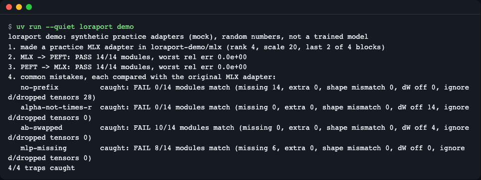
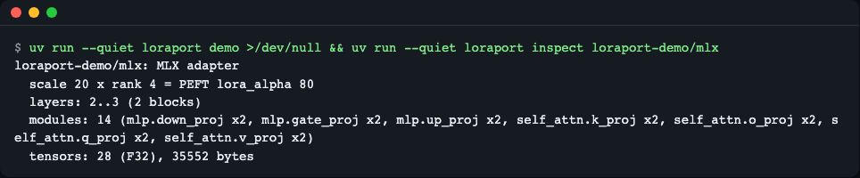
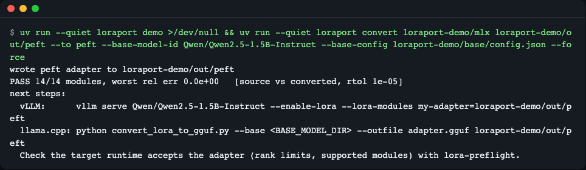
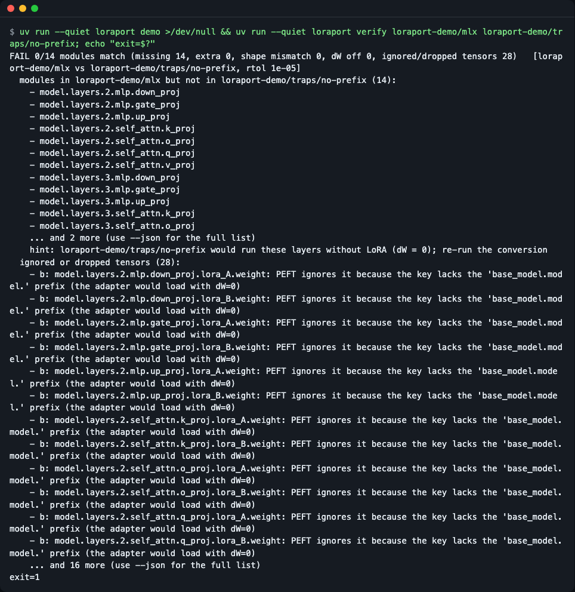
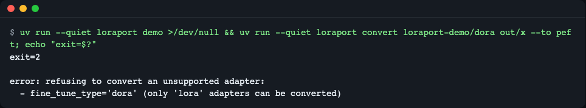
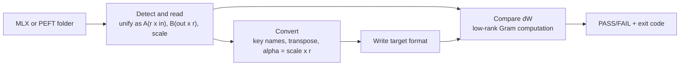

# loraport

[한국어](README.md) | **English**

loraport is a command-line tool that converts LoRA adapters trained on a Mac with `mlx_lm.lora` into the PEFT format (so PEFT, vLLM and llama.cpp can use them) and back, and **proves with numbers that the weight delta (dW) is the same after the trip**. It saves you from hand-writing key renames, transposes and the `alpha = scale x r` calculation, and from finding months later that an adapter loaded silently with dW = 0.


*`loraport demo`: two round-trip conversions PASS, and four common mistakes are all caught as FAIL (synthetic practice adapters).*

## Who it is for
- You fine-tune small models with mlx-lm on an Apple Silicon Mac and want to serve on a Linux GPU (vLLM) or with llama.cpp
- You want to try a PEFT adapter from the hub on a Mac with mlx-lm
- You want CI to check automatically that a conversion script still produces the same adapter

## Install
```bash
curl -LsSf https://astral.sh/uv/install.sh | sh   # if you do not have uv
uv tool install git+https://github.com/LeeGyeongPil/loraport
```
Or clone and run directly (every command below was run this way).
```bash
git clone https://github.com/LeeGyeongPil/loraport && cd loraport
uv run loraport --version
```
```text
loraport 0.1.2
```
- Requires Python 3.11+ (`.python-version` pins 3.12). The only dependencies are `numpy` and `safetensors`, so it runs on macOS and Linux without torch or mlx.
- On a minimal Linux image you only need `git` and `curl` in addition.

## Quick start
```bash
uv run loraport demo
```
```text
loraport demo: synthetic practice adapters (mock), random numbers, not a trained model
1. made a practice MLX adapter in loraport-demo/mlx (rank 4, scale 20, last 2 of 4 blocks)
2. MLX -> PEFT: PASS 14/14 modules, worst rel err 0.0e+00
3. PEFT -> MLX: PASS 14/14 modules, worst rel err 0.0e+00
4. common mistakes, each compared with the original MLX adapter:
   no-prefix          caught: FAIL 0/14 modules match (missing 14, extra 0, shape mismatch 0, dW off 0, ignored/dropped tensors 28)
   alpha-not-times-r  caught: FAIL 0/14 modules match (missing 0, extra 0, shape mismatch 0, dW off 14, ignored/dropped tensors 0)
   ab-swapped         caught: FAIL 10/14 modules match (missing 0, extra 0, shape mismatch 0, dW off 4, ignored/dropped tensors 0)
   mlp-missing        caught: FAIL 8/14 modules match (missing 6, extra 0, shape mismatch 0, dW off 0, ignored/dropped tensors 0)
4/4 traps caught
```
**This is a practice (mock) mode.** `demo` builds a small synthetic adapter from random numbers (hidden size 64, 4 layers) in `loraport-demo/`, not a trained model. The output is not faked: the same conversion and verification code that runs on real adapters runs here. No network, GPU or API key is needed, and it finishes in about a second.

How to read it: lines 2 and 3 mean the dW of every module is unchanged after converting there and back (`worst rel err` is the largest relative error). Line 4 means all four deliberately broken adapters were caught as FAIL.

## Usage
| Command | What it does | Example |
|---|---|---|
| `inspect <dir> [--json]` | format, rank, scale, layers, module list, tensor count | `loraport inspect adapters` |
| `convert <src> <dst> --to peft\|mlx` | convert to the other format, verify automatically, print next steps | `loraport convert adapters out/peft --to peft` |
| `verify <A> <B> [--rtol 1e-5] [--json]` | compare dW of two adapters (any format) per module | `loraport verify adapters out/peft` |
| `demo [--out dir]` | run the whole flow on synthetic practice adapters | `loraport demo` |

`convert` options: `--base-config` (the base model's `config.json` or its folder; checks module sizes and layer range), `--base-model-id` (hub name written to `base_model_name_or_path`), `--rtol` (allowed relative error, default 1e-5), `--no-verify`, `--force` (overwrite adapter files already in the destination).

Exit codes: **0** pass / **1** mismatch (verification failed) / **2** input error, unsupported adapter type, or destination already exists.

### 1) Inspect an adapter
```bash
uv run loraport inspect loraport-demo/mlx
```
```text
loraport-demo/mlx: MLX adapter
  scale 20 x rank 4 = PEFT lora_alpha 80
  layers: 2..3 (2 blocks)
  modules: 14 (mlp.down_proj x2, mlp.gate_proj x2, mlp.up_proj x2, self_attn.k_proj x2, self_attn.o_proj x2, self_attn.q_proj x2, self_attn.v_proj x2)
  tensors: 28 (F32), 35552 bytes
```

*MLX scale 20 maps to PEFT `lora_alpha` 80 (= 20 x rank 4).*

With `--json` the same information comes out as JSON with keys such as `format`, `rank`, `scale`, `lora_alpha`, `layers`, `modules` and `tensor_count`.

### 2) Convert to PEFT
```bash
uv run loraport convert loraport-demo/mlx loraport-demo/out/peft --to peft \
  --base-model-id Qwen/Qwen2.5-1.5B-Instruct --base-config loraport-demo/base/config.json
```
```text
wrote peft adapter to loraport-demo/out/peft
PASS 14/14 modules, worst rel err 0.0e+00   [source vs converted, rtol 1e-05]
next steps:
  vLLM:      vllm serve Qwen/Qwen2.5-1.5B-Instruct --enable-lora --lora-modules my-adapter=loraport-demo/out/peft
  llama.cpp: python convert_lora_to_gguf.py --base <BASE_MODEL_DIR> --outfile adapter.gguf loraport-demo/out/peft
  Check the target runtime accepts the adapter (rank limits, supported modules) with lora-preflight.
```

*After converting, the automatic verification result and the next vLLM / llama.cpp commands are shown.*

- The result is `adapter_model.safetensors` (metadata `format=pt`) plus `adapter_config.json`. Only the needed fields are written to the config; training arguments such as data paths are not copied.
- The other direction is `--to mlx`. With `--base-config`, `num_layers` is computed as `total layers - first adapted layer index`; without it, `-1` (all blocks) is written.
- Without `--base-model-id`, `base_model_name_or_path` is `null`.
- `<BASE_MODEL_DIR>` in the llama.cpp line is a placeholder you fill in. The tool only prints the vLLM and llama.cpp commands; it does not run them.

### 3) Compare two adapters (CI)
```bash
uv run loraport verify loraport-demo/mlx loraport-demo/out/peft; echo "exit=$?"
```
```text
PASS 14/14 modules, worst rel err 0.0e+00   [loraport-demo/mlx vs loraport-demo/out/peft, rtol 1e-05]
exit=0
```
`--json` prints a report with `ok`, `missing`, `extra`, `shape_mismatch`, `key_issues`, `worst_rel_err` and `per_module`. In CI, block the build on exit code 1.

### 4) Catching a silent failure
`traps/no-prefix`, created by `demo`, is an adapter whose PEFT keys lack the `base_model.model.` prefix. Real PEFT only warns and loads it with dW = 0 (no error).
```bash
uv run loraport verify loraport-demo/mlx loraport-demo/traps/no-prefix; echo "exit=$?"
```
```text
FAIL 0/14 modules match (missing 14, extra 0, shape mismatch 0, dW off 0, ignored/dropped tensors 28)   [loraport-demo/mlx vs loraport-demo/traps/no-prefix, rtol 1e-05]
  modules in loraport-demo/mlx but not in loraport-demo/traps/no-prefix (14):
    - model.layers.2.mlp.down_proj
    ...
    hint: loraport-demo/traps/no-prefix would run these layers without LoRA (dW = 0); re-run the conversion
  ignored or dropped tensors (28):
    - b: model.layers.2.mlp.down_proj.lora_A.weight: PEFT ignores it because the key lacks the 'base_model.model.' prefix (the adapter would load with dW=0)
    ...
exit=1
```
(Middle lines are shortened to `...`; use `--json` for the full lists.)


*The adapter with missing prefixes fails (exit code 1) with the reason "would load with dW = 0".*

### 5) Unsupported adapter types are refused
A DoRA adapter (`fine_tune_type: dora`) is refused with a reason instead of being converted wrongly; nothing is written. Reproduce it with the `loraport-demo/dora` folder that `demo` creates.
```bash
uv run loraport convert loraport-demo/dora out/x --to peft; echo "exit=$?"
```
```text
error: refusing to convert an unsupported adapter:
  - fine_tune_type='dora' (only 'lora' adapters can be converted)
exit=2
```

*Unsupported types give exit code 2 and a reason.*

### Using it from Python
`adapters` is the default output folder of `mlx_lm.lora` (if you follow the demo, use `loraport-demo/mlx`). To import it as a library, run `uv add git+https://github.com/LeeGyeongPil/loraport` (or `pip install git+https://github.com/LeeGyeongPil/loraport`) in your project; `uv tool install` installs the CLI only.
```python
from loraport import load_adapter, convert, compare

result = convert("adapters", "out/peft", "peft", base_model_id="Qwen/Qwen2.5-1.5B-Instruct")
print(result.report.ok, result.report.worst_rel_err)   # True 0.0

report = compare(load_adapter("adapters"), load_adapter("out/peft"))
print(report.ok, len(report.per_module))               # True 14 (for the demo adapter)
```
Public API: `load_adapter`, `convert`, `compare`, `save_peft`, `save_mlx`. Exceptions: `LoraportError` (subclasses `AdapterFormatError`, `UnsupportedAdapterError`).

## Configuration
There are no config files, environment variables or API keys. Everything is set with command options. `--rtol` defaults to 1e-5. Input may be F32, F16 or BF16 safetensors; output is always float32.

## How it works
The two formats write the same dW differently.

| | mlx-lm | PEFT |
|---|---|---|
| weights file | `adapters.safetensors` | `adapter_model.safetensors` |
| key | `model.layers.{i}.{mod}.lora_a` / `.lora_b` | `base_model.model.model.layers.{i}.{mod}.lora_A.weight` / `.lora_B.weight` |
| A shape | `(in, r)` | `(r, in)` |
| B shape | `(r, out)` | `(out, r)` |
| scale | `scale` | `lora_alpha / r` (`lora_alpha / sqrt(r)` with rslora) |
| layer range | `num_layers` (count from the last block, `-1` = all) | `layers_to_transform` list |


1. Whatever the format, adapters are read into the PEFT layout (`A (r,in)`, `B (out,r)`) with module names `model.layers.{i}.{mod}`.
2. Conversion renames keys, transposes A and B, and converts the scale with `lora_alpha = scale x r` (reverse: `scale = alpha / r`, rslora: `alpha / sqrt(r)`). Reading is lenient and converting is strict: mismatched A/B ranks and unsupported items are refused before anything is written.
3. Verification measures `||dW1 - dW2|| / ||dW1||` (Frobenius norm) per module. It never builds the out x in matrix: it uses `||UV||^2 = trace((U^T U)(V V^T))` in float64, so even large modules need little memory. Because of the squaring, the relative error floor is about 1e-8.
4. It also reports modules that are missing, extra or differently shaped, and keys a runtime would ignore (such as a missing prefix).

### Four common pitfalls (reproduced by demo)
| Name | The mistake | How it is caught |
|---|---|---|
| `no-prefix` | PEFT keys lack the `base_model.model.` prefix | 14 modules missing + 28 ignored keys |
| `alpha-not-times-r` | `lora_alpha = scale` (x r forgotten) | dW mismatch in 14 modules |
| `ab-swapped` | A and B swapped on square modules (q/o) | shapes pass, dW mismatch in 4 modules |
| `mlp-missing` | MLP tensors dropped | 6 modules missing |

Format notes and sources: [docs/format-notes.md](docs/format-notes.md).

## When to use it
- Good fit: you want to hand an mlx-lm adapter to PEFT-based tools without merging it, and keep a numeric record that the conversion matches the original.
- Other tools: for a merged full model use [mlx-lm `fuse`](https://github.com/ml-explore/mlx-lm/blob/main/mlx_lm/LORA.md); to turn a PEFT adapter into a GGUF LoRA use [llama.cpp `convert_lora_to_gguf.py`](https://github.com/ggml-org/llama.cpp); to predict whether vLLM or llama.cpp will accept an adapter that is already in PEFT format, use lora-preflight (a separate tool, not published yet).

## Unsupported and limits
- Refused in 0.1.2: DoRA, MoE (3-D tensors), embedding LoRA, `modules_to_save`, `rank_pattern`/`alpha_pattern`, bias adapters. Writing GGUF directly, merging into the base model and downloading from the hub (local folders only) are out of scope.
- **Only dW equality is proven.** Attached to a quantized base model, outputs may differ slightly (output equality is not guaranteed).
- **Loading in mlx-lm itself was not verified.** The format was checked against the installed mlx-lm 0.32.2 source and the header of a real mlx-lm adapter on the hub, but `load_adapters` from `mlx_lm` could not be run in the development environment (no Metal device). The behavior of `num_layers=-1` and of layers missing from the file staying at dW = 0 for `--to mlx` also rests on reading the source. On a normal Mac terminal you can run the round-trip test with `uv run --with mlx-lm pytest -m mlx`; that command has not been run yet.
- The whole adapter is loaded into memory as float32 (no streaming). Adapters up to a few hundred MB are fine.
- Versions checked (2026-11-11): numpy 2.5.4, safetensors 0.8.0, optional extra `peft` 0.21.2 / torch 2.15.0 / transformers 5.22.2, mlx-lm 0.32.2 (read from source).

## Troubleshooting
| Symptom | Cause | Fix |
|---|---|---|
| `error: ... already contains adapter files; pass --force` (exit 2) | the destination already has adapter files | use another folder or `--force` |
| `error: ...: no such directory` (exit 2) | a typo in the path | check the adapter folder path |
| `refusing to convert an unsupported adapter` (exit 2) | DoRA, MoE or another unsupported type | read the reasons; retrain and save as a plain LoRA adapter |
| `verify` FAILs with `shape mismatch` | A/B were not transposed | convert again with `convert` |
| `verify` FAILs with `ignored or dropped tensors` | PEFT keys lack the `base_model.model.` prefix | convert again with `convert` |
| FAIL with `dW differs` | scale (`alpha = scale x r`) or A/B order mistake | follow the hint line and re-convert; do not loosen `--rtol` to hide it |
| Weak effect after llama.cpp conversion | `convert_lora_to_gguf.py` does not read `use_rslora` | loraport always writes `use_rslora=false` with `lora_alpha = scale x r`, so its output avoids this |

## Development
```bash
uv run pytest -q
```
```text
72 passed, 2 skipped in 1.70s
```
The two skipped tests are optional (real PEFT integration, Mac-only mlx integration). Run the PEFT one with `uv run --extra peft pytest -q -m peft tests/test_peft_integration.py` (the first run takes over a minute because of torch; `1 passed` in the development environment).

Report bugs and ideas as issues. Changes are listed in [CHANGELOG.md](CHANGELOG.md).

## License
MIT. The repo ships no external models or data; test adapters are generated at run time.
