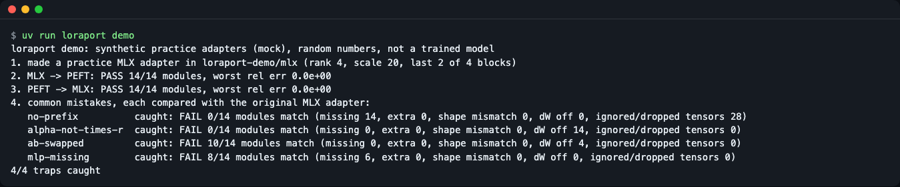
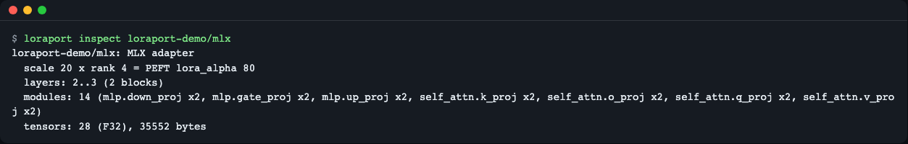
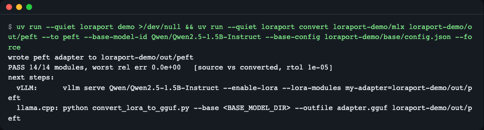
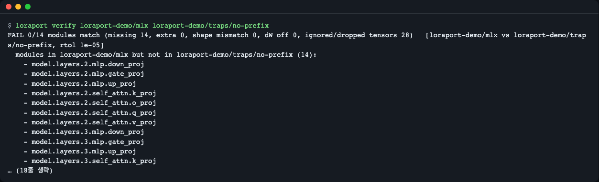
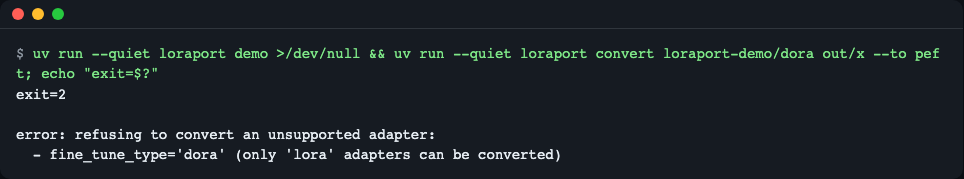
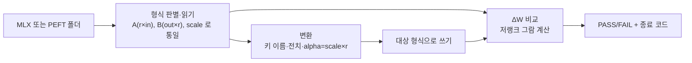

# loraport

**한국어** | [English](README.en.md)

> **English summary** — loraport converts LoRA adapters between the mlx-lm (Apple Silicon) format and the PEFT format, and proves with numbers that the weight delta (dW) is unchanged after the trip. Use it when you trained on a Mac and want to serve the adapter with PEFT, vLLM or llama.cpp (or the other way round). Try it with `uv run loraport demo` (synthetic practice adapters, no downloads).

맥에서 `mlx_lm.lora` 로 학습한 LoRA 어댑터를 PEFT·vLLM·llama.cpp 쪽 형식으로 옮기고(반대 방향도), **옮긴 뒤에도 가중치 변화량(ΔW)이 원본과 같은지 숫자로 확인**하는 명령줄 도구입니다. 키 이름 바꾸기·전치·`alpha = scale × r` 계산을 손으로 짜다가, 에러 없이 ΔW=0 으로 적재되는 조용한 실패를 몇 달 뒤에야 발견하는 일을 줄입니다.


*`loraport demo`: 왕복 변환 두 번이 PASS, 흔한 실수 4가지가 모두 FAIL 로 잡힌다(연습용 합성 어댑터).*

## 이런 분께
- 맥(Apple Silicon)에서 mlx-lm 으로 소형 모델을 미세조정하고, 서빙은 리눅스 GPU(vLLM)나 llama.cpp 에서 하려는 분
- 허브의 PEFT 어댑터를 맥에서 mlx-lm 으로 돌려 보려는 분
- 변환 스크립트가 바뀔 때마다 "결과가 원본과 같은가"를 CI 에서 자동으로 확인하고 싶은 분

## 설치
```bash
curl -LsSf https://astral.sh/uv/install.sh | sh   # uv 가 없다면
uv tool install git+https://github.com/LeeGyeongPil/loraport
```
저장소를 받아서 바로 써 볼 수도 있습니다(아래 모든 명령은 이 방식으로 실행해 확인했습니다).
```bash
git clone https://github.com/LeeGyeongPil/loraport && cd loraport
uv run loraport --version
```
```text
loraport 0.1.3
```
- 필요한 것: Python 3.11 이상(`.python-version` 은 3.12). 의존성은 `numpy`·`safetensors` 뿐이라 torch·mlx 없이 맥·리눅스 어디서나 돕니다.
- 최소 리눅스 환경에서는 `git`, `curl` 정도만 더 있으면 됩니다.

## 빠르게 시작하기
```bash
uv run loraport demo
```
```text
loraport demo: synthetic practice adapters (mock), random numbers, not a trained model
1. made a practice MLX adapter in loraport-demo/mlx (rank 4, scale 20, last 2 of 4 blocks)
2. MLX -> PEFT: PASS 14/14 modules, worst rel err 0.0e+00
3. PEFT -> MLX: PASS 14/14 modules, worst rel err 0.0e+00
4. common mistakes, each compared with the original MLX adapter:
   no-prefix          caught: FAIL 0/14 modules match (missing 14, extra 0, shape mismatch 0, dW off 0, ignored/dropped tensors 28)
   alpha-not-times-r  caught: FAIL 0/14 modules match (missing 0, extra 0, shape mismatch 0, dW off 14, ignored/dropped tensors 0)
   ab-swapped         caught: FAIL 10/14 modules match (missing 0, extra 0, shape mismatch 0, dW off 4, ignored/dropped tensors 0)
   mlp-missing        caught: FAIL 8/14 modules match (missing 6, extra 0, shape mismatch 0, dW off 0, ignored/dropped tensors 0)
4/4 traps caught
```
**연습용 목(mock) 모드입니다.** `demo` 는 학습된 모델이 아니라 무작위 숫자로 만든 작은 합성 어댑터(hidden 64, 4층)를 `loraport-demo/` 에 만듭니다. 출력을 꾸며 낸 것은 아니고, 변환 코드와 검증 코드는 실제 어댑터에 쓰는 것과 같은 코드가 그대로 돕니다. 네트워크·GPU·API 키가 필요 없고 1초 안에 끝납니다.

읽는 법: 2·3번 줄은 "옮겼다가 돌아와도 모든 모듈의 ΔW 가 같다"는 뜻입니다(`worst rel err` 가 가장 큰 상대 오차). 4번은 일부러 틀리게 만든 어댑터 4종이 모두 FAIL 로 잡혔다는 뜻입니다.

## 사용법
| 명령 | 하는 일 | 예 |
|---|---|---|
| `inspect <폴더> [--json]` | 형식·rank·배율·층·모듈 목록·텐서 수 | `loraport inspect adapters` |
| `convert <원본> <대상> --to peft\|mlx` | 다른 형식으로 변환 후 자동 검증, 다음 단계 명령 안내 | `loraport convert adapters out/peft --to peft` |
| `verify <A> <B> [--rtol 1e-5] [--json]` | 두 어댑터(형식 무관)의 ΔW 를 모듈별로 비교 | `loraport verify adapters out/peft` |
| `demo [--out 폴더]` | 연습용 합성 어댑터로 전체 흐름 시연 | `loraport demo` |

`convert` 옵션: `--base-config`(기본 모델의 `config.json` 또는 그 폴더 — 모듈 크기·층 범위 대조), `--base-model-id`(PEFT 설정의 `base_model_name_or_path` 에 쓸 허브 이름), `--rtol`(허용 상대 오차, 기본 1e-5), `--no-verify`, `--force`(대상 폴더의 기존 어댑터 파일 덮어쓰기).

종료 코드: **0** 통과 / **1** 불일치(검증 실패) / **2** 입력 오류·지원 안 하는 형태·이미 있는 대상.

### 1) 어댑터 살펴보기
```bash
uv run loraport inspect loraport-demo/mlx
```
```text
loraport-demo/mlx: MLX adapter
  scale 20 x rank 4 = PEFT lora_alpha 80
  layers: 2..3 (2 blocks)
  modules: 14 (mlp.down_proj x2, mlp.gate_proj x2, mlp.up_proj x2, self_attn.k_proj x2, self_attn.o_proj x2, self_attn.q_proj x2, self_attn.v_proj x2)
  tensors: 28 (F32), 35552 bytes
```

*MLX 의 scale 20 이 PEFT 의 `lora_alpha` 80(= 20 × rank 4)으로 환산되는 모습.*

`--json` 을 붙이면 같은 정보를 `format`·`rank`·`scale`·`lora_alpha`·`layers`·`modules`·`tensor_count` 등의 키로 가진 JSON 으로 냅니다.

### 2) PEFT 형식으로 변환하기
```bash
uv run loraport convert loraport-demo/mlx loraport-demo/out/peft --to peft \
  --base-model-id Qwen/Qwen2.5-1.5B-Instruct --base-config loraport-demo/base/config.json
```
```text
wrote peft adapter to loraport-demo/out/peft
PASS 14/14 modules, worst rel err 0.0e+00   [source vs converted, rtol 1e-05]
next steps:
  vLLM:      vllm serve Qwen/Qwen2.5-1.5B-Instruct --enable-lora --lora-modules my-adapter=loraport-demo/out/peft
  llama.cpp: python convert_lora_to_gguf.py --base <BASE_MODEL_DIR> --outfile adapter.gguf loraport-demo/out/peft
```

*변환이 끝나면 자동 검증 결과와 vLLM·llama.cpp 다음 명령이 나온다.*

- 변환 결과는 `adapter_model.safetensors`(메타데이터 `format=pt`)와 `adapter_config.json` 입니다. 설정에는 필요한 필드만 쓰고 학습 인자(데이터 경로 등)는 복사하지 않습니다.
- 반대 방향은 `--to mlx`. `--base-config` 가 있으면 `num_layers` 를 `전체 층 수 − 가장 앞 층 번호` 로 계산하고, 없으면 `-1`(모든 블록)로 씁니다.
- `--base-model-id` 를 주지 않으면 `base_model_name_or_path` 는 `null` 입니다.
- `llama.cpp` 줄의 `<BASE_MODEL_DIR>` 는 직접 채우는 자리표시입니다. llama.cpp·vLLM 명령 자체는 이 도구가 실행하지 않고 안내만 합니다.

### 3) 두 어댑터 비교하기(CI)
```bash
uv run loraport verify loraport-demo/mlx loraport-demo/out/peft; echo "exit=$?"
```
```text
PASS 14/14 modules, worst rel err 0.0e+00   [loraport-demo/mlx vs loraport-demo/out/peft, rtol 1e-05]
exit=0
```
`--json` 은 `ok`·`missing`·`extra`·`shape_mismatch`·`key_issues`·`worst_rel_err`·`per_module` 을 담은 보고서를 냅니다. CI 에서는 종료 코드 1 이면 빌드를 막으면 됩니다.

### 4) 조용한 실패를 잡는 모습
`demo` 가 만든 `traps/no-prefix` 는 PEFT 키에서 `base_model.model.` 접두사가 빠진 어댑터입니다. 실제 PEFT 는 이 경우 경고만 내고 ΔW=0 으로 적재합니다(에러 없음).
```bash
uv run loraport verify loraport-demo/mlx loraport-demo/traps/no-prefix; echo "exit=$?"
```
```text
FAIL 0/14 modules match (missing 14, extra 0, shape mismatch 0, dW off 0, ignored/dropped tensors 28)   [loraport-demo/mlx vs loraport-demo/traps/no-prefix, rtol 1e-05]
  modules in loraport-demo/mlx but not in loraport-demo/traps/no-prefix (14):
    - model.layers.2.mlp.down_proj
    ...
    hint: loraport-demo/traps/no-prefix would run these layers without LoRA (dW = 0); re-run the conversion
  ignored or dropped tensors (28):
    - b: model.layers.2.mlp.down_proj.lora_A.weight: PEFT ignores it because the key lacks the 'base_model.model.' prefix (the adapter would load with dW=0)
    ...
exit=1
```
(중간 줄은 `...` 로 줄였습니다. 전체 목록은 `--json`.)


*접두사 누락 어댑터는 "ΔW=0 으로 적재될 것"이라는 이유와 함께 FAIL(종료 코드 1).*

### 5) 지원하지 않는 형태는 거부
DoRA 어댑터(`fine_tune_type: dora`)는 조용히 망가뜨리지 않고 이유와 함께 거부합니다(아무것도 쓰지 않음). `demo` 가 만든 `loraport-demo/dora` 로 재현합니다.
```bash
uv run loraport convert loraport-demo/dora out/x --to peft; echo "exit=$?"
```
```text
error: refusing to convert an unsupported adapter:
  - fine_tune_type='dora' (only 'lora' adapters can be converted)
exit=2
```

*지원 안 하는 형태는 종료 코드 2 와 이유.*

### Python 에서 쓰기
`adapters` 는 `mlx_lm.lora` 가 학습 결과를 저장하는 기본 폴더입니다(데모로 따라 한다면 `loraport-demo/mlx`). 라이브러리로 쓰려면 프로젝트에 `uv add git+https://github.com/LeeGyeongPil/loraport`(또는 `pip install git+https://github.com/LeeGyeongPil/loraport`)로 설치합니다. `uv tool install` 은 CLI 만 설치합니다.
```python
from loraport import load_adapter, convert, compare

result = convert("adapters", "out/peft", "peft", base_model_id="Qwen/Qwen2.5-1.5B-Instruct")
print(result.report.ok, result.report.worst_rel_err)   # True 0.0

report = compare(load_adapter("adapters"), load_adapter("out/peft"))
print(report.ok, len(report.per_module))               # True 14 (demo 어댑터 기준)
```
공개 API: `load_adapter`, `convert`, `compare`, `save_peft`, `save_mlx`. 예외는 `LoraportError`(하위 `AdapterFormatError`, `UnsupportedAdapterError`).

## 설정
설정 파일·환경변수·API 키는 없습니다. 모든 동작은 명령 옵션으로 정합니다. `--rtol` 기본값은 1e-5 이며, 입력은 F32·F16·BF16 safetensors 를 읽고 출력은 항상 float32 입니다.

## 동작 원리
같은 ΔW 를 두 형식이 다르게 적습니다.

| | mlx-lm | PEFT |
|---|---|---|
| 가중치 파일 | `adapters.safetensors` | `adapter_model.safetensors` |
| 키 | `model.layers.{i}.{mod}.lora_a` / `.lora_b` | `base_model.model.model.layers.{i}.{mod}.lora_A.weight` / `.lora_B.weight` |
| A 모양 | `(in, r)` | `(r, in)` |
| B 모양 | `(r, out)` | `(out, r)` |
| 배율 | `scale` | `lora_alpha / r` (rslora 면 `lora_alpha / √r`) |
| 층 범위 | `num_layers`(뒤에서부터 센 개수, `-1` 은 전부) | `layers_to_transform` 목록 |


1. 어느 형식이든 내부에서는 PEFT 배치(`A (r,in)`, `B (out,r)`)와 모듈 이름 `model.layers.{i}.{mod}` 로 통일해 읽습니다.
2. 변환은 키 이름을 바꾸고, A·B 를 전치하고, `lora_alpha = scale × r`(역방향은 `scale = alpha / r`, rslora 는 `alpha / √r`)로 배율을 환산합니다. 읽기는 관대하고 변환은 엄격해서, A/B 랭크 불일치·지원 안 하는 항목은 쓰기 전에 거부합니다.
3. 검증은 모듈마다 `‖ΔW₁ − ΔW₂‖ / ‖ΔW₁‖`(프로베니우스 노름)를 잽니다. out×in 행렬을 만들지 않고 `‖UV‖² = trace((UᵀU)(VVᵀ))` 로 float64 로 계산하므로 큰 모듈도 메모리가 작게 듭니다. 제곱을 거치므로 상대 오차 하한은 약 1e-8 입니다.
4. 모듈이 빠졌는지·더해졌는지·모양이 다른지, 그리고 런타임이 무시할 키(접두사 누락 등)가 없는지도 함께 보고합니다.

### 흔한 함정 4가지(demo 가 재현)
| 이름 | 무슨 실수인가 | 잡히는 방식 |
|---|---|---|
| `no-prefix` | PEFT 키에서 `base_model.model.` 접두사 누락 | 모듈 14개 missing + 무시되는 키 28개 |
| `alpha-not-times-r` | `lora_alpha = scale`(× r 누락) | 14개 모듈 ΔW 불일치 |
| `ab-swapped` | 정사각 모듈(q/o)에서 A·B 를 바꿔 넣음 | 모양은 통과, ΔW 만 4개 모듈 불일치 |
| `mlp-missing` | MLP 텐서 누락 | 모듈 6개 missing |

자세한 형식 메모와 출처: [docs/format-notes.md](docs/format-notes.md).

## 언제 쓰나
- 이럴 때: mlx-lm 어댑터를 병합하지 않고 그대로 PEFT 계열 도구에 넘기고 싶을 때, 변환 결과가 원본과 같은지 숫자로 남기고 싶을 때.
- 이럴 땐 다른 도구: 기본 모델에 병합한 전체 모델이 필요하면 [mlx-lm `fuse`](https://github.com/ml-explore/mlx-lm/blob/main/mlx_lm/LORA.md), PEFT 어댑터를 GGUF LoRA 로 바꾸려면 [llama.cpp `convert_lora_to_gguf.py`](https://github.com/ggml-org/llama.cpp).

## 지원 안 하는 것과 한계
- 0.1.3 에서 거부하는 형태: DoRA, MoE(3차원 텐서), embedding LoRA, `modules_to_save`, `rank_pattern`/`alpha_pattern`, bias 어댑터. GGUF 직접 쓰기, 기본 모델 병합, 허브 다운로드(로컬 폴더만)도 범위 밖입니다.
- **ΔW 동일성만 증명합니다.** 양자화한 기본 모델에 붙이면 출력은 조금 달라질 수 있습니다(출력 동일성은 보장하지 않음).
- **mlx-lm 쪽은 실제 로드를 확인하지 못했습니다.** 형식은 mlx-lm 0.32.2 설치본 소스와 허브의 실제 mlx-lm 어댑터 헤더로 확인했고, 개발 환경(Metal 장치 없음)에서 `mlx_lm` 의 `load_adapters` 를 직접 돌려 보지는 못했습니다. `--to mlx` 의 `num_layers=-1`·파일에 없는 층이 ΔW=0 으로 남는다는 동작도 소스를 읽은 근거입니다. 맥의 일반 터미널에서는 `uv run --with mlx-lm pytest -m mlx` 로 왕복 테스트를 돌려 볼 수 있는데, 이 명령은 아직 실행해 보지 않았습니다.
- 어댑터 전체를 float32 로 메모리에 올립니다(스트리밍 아님). 수백 MB 급까지는 가능합니다.
- 확인한 버전(2026-11-11): numpy 2.5.4, safetensors 0.8.0, 선택 extra `peft` 0.21.2·torch 2.15.0·transformers 5.22.2, mlx-lm 0.32.2(소스 판독).

## 자주 겪는 문제
| 증상 | 원인 | 해결 |
|---|---|---|
| `error: ... already contains adapter files; pass --force` (종료 코드 2) | 대상 폴더에 이미 어댑터 파일이 있음 | 다른 폴더를 쓰거나 `--force` |
| `error: ...: no such directory` (종료 코드 2) | 경로 오타 | 어댑터 폴더 경로를 확인 |
| `refusing to convert an unsupported adapter` (종료 코드 2) | DoRA·MoE 등 지원 안 하는 형태 | 이유 목록을 확인하고 LoRA 어댑터로 다시 학습·저장 |
| `verify` 가 `shape mismatch` 로 FAIL | A/B 를 전치하지 않은 어댑터 | `convert` 로 다시 변환 |
| `verify` 가 `ignored or dropped tensors` 로 FAIL | PEFT 키에 `base_model.model.` 접두사가 없음 | `convert` 로 다시 변환 |
| `dW differs` 로 FAIL | 배율(`alpha = scale × r`) 또는 A/B 순서 실수 | hint 줄을 따라 변환을 다시 하고, `--rtol` 을 풀어 덮지 않기 |
| llama.cpp 변환 후 효과가 약함 | `convert_lora_to_gguf.py` 는 `use_rslora` 를 읽지 않음 | loraport 는 항상 `use_rslora=false` + `lora_alpha = scale × r` 로 쓰므로 loraport 출력은 이 문제를 피함 |

## 개발·기여
```bash
uv run pytest -q
```
```text
72 passed, 2 skipped in 1.70s
```
건너뛴 2개는 선택 테스트(실제 PEFT 통합, 맥 전용 mlx 통합)입니다. PEFT 통합은 `uv run --extra peft pytest -q -m peft tests/test_peft_integration.py` 로 돌립니다(torch 설치 때문에 첫 실행은 1분 넘게 걸림. 개발 환경에서 `1 passed`).

버그·제안은 이슈로 남겨 주세요. 변경 기록은 [CHANGELOG.md](CHANGELOG.md).

## 라이선스
MIT. 레포에 외부 모델·데이터는 들어 있지 않고 테스트 어댑터는 모두 실행 중에 생성합니다.
